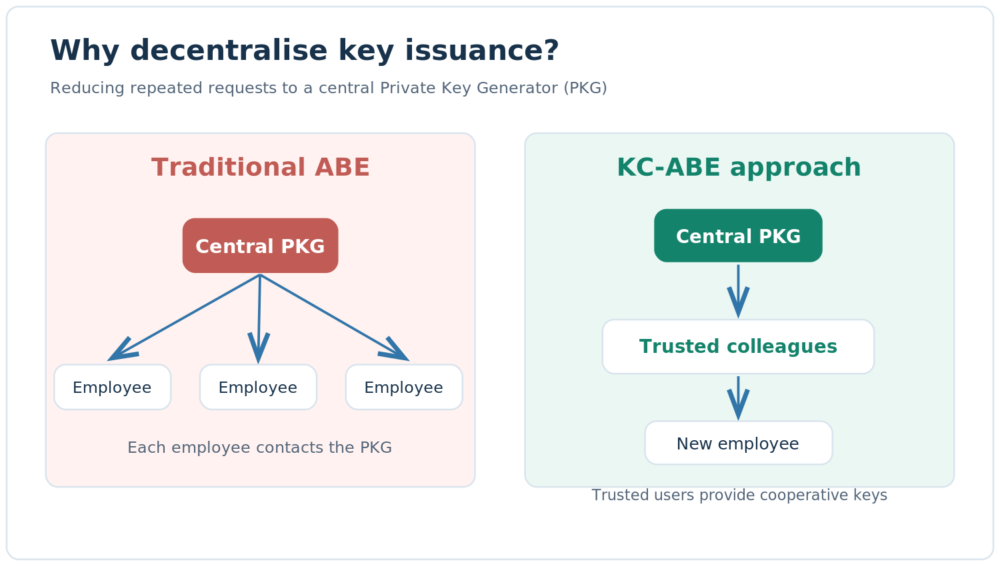
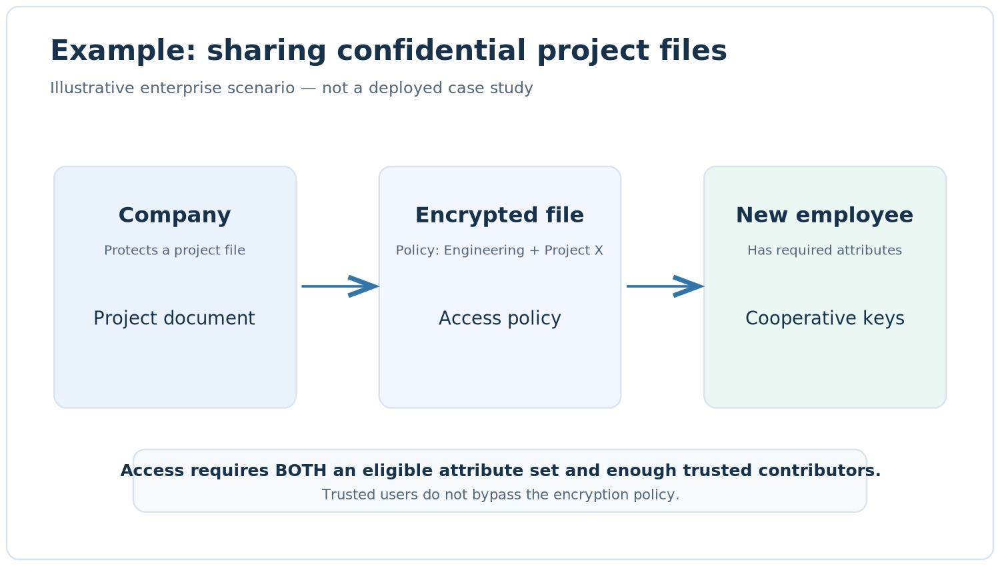
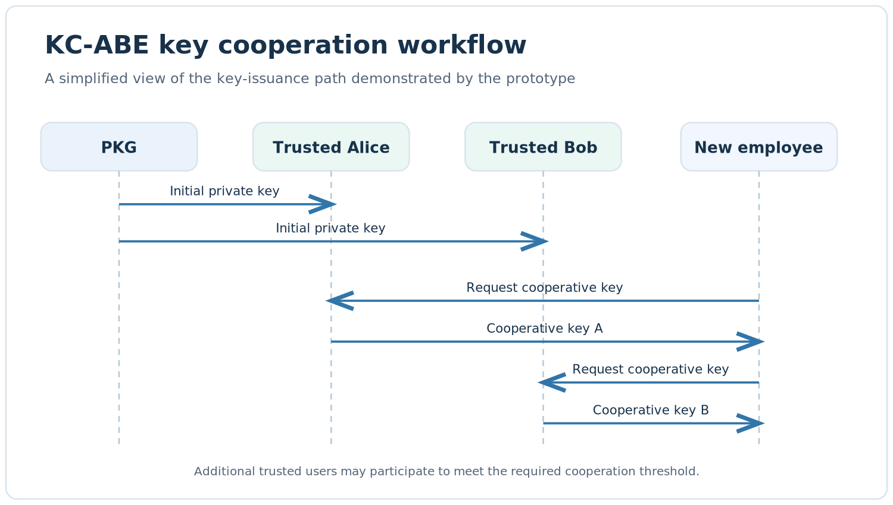
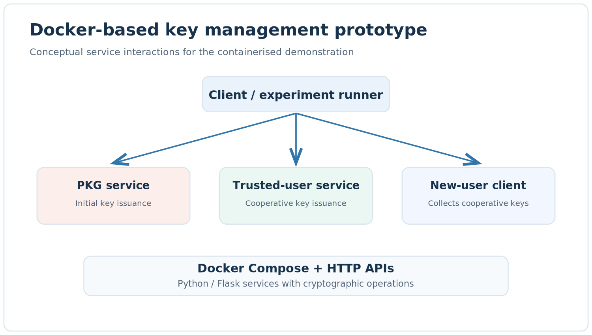
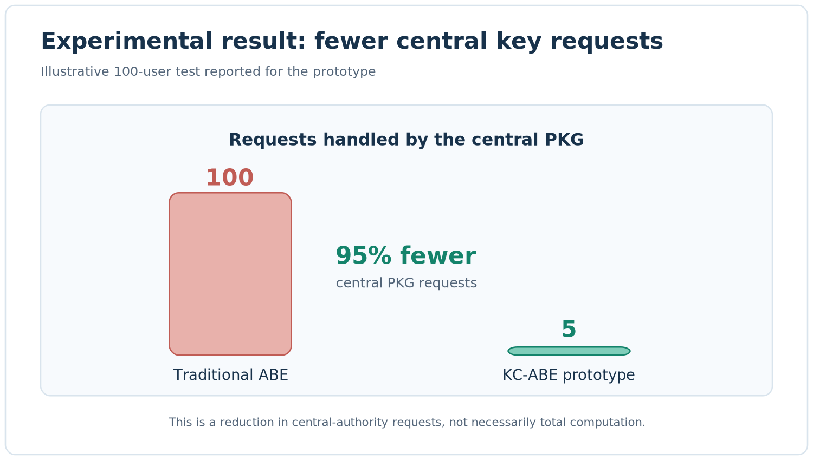

# Decentralised Key Management with KC-ABE 

**What if a company didn't need to contact one central server every time someone needed an encryption key?**

This project explores that question with **Key Cooperative Attribute-Based Encryption (KC-ABE)**. Instead of asking a central authority to issue a key for every user, a small group of trusted users can help other users obtain cooperative keys.

**Built with:** Python · Flask · Charm-Crypto · Docker Compose · HTTP APIs

> **Research prototype, not a production security product.** This repository demonstrates **key setup and cooperative key issuance**. Full encryption and decryption (`Enc`, `PDec`, `UDec`) are described in the [research paper](#research-background) but **not implemented in this repository**.

##  The problem, in plain English

Imagine a company with hundreds of employees accessing protected documents. Each employee needs a cryptographic key tied to their permitted attributes (for example, their department).

In a conventional attribute-based encryption system, a **Private Key Generator (PKG)** issues everyone's private keys. As the company grows, this central service has to handle more and more requests.

**Our idea:** let a small number of already-authorised, trusted users help distribute *cooperative decryption keys*. The PKG still sets up the system and enrols those trusted users, but it doesn't need to handle every subsequent user's request.

### Before and after



*Conceptual illustration. The trusted users issue separate cooperative keys; the diagram does not mean that they share their original PKG private keys.*

##  Example: a company sharing confidential project files

**Illustrative application scenario (not a deployed enterprise case study).**

Suppose a company encrypts a project document for employees with the required attributes, such as `Engineering` and `Project-X`. The document's encryption policy also requires a minimum number of trusted contributors for cooperative decryption.

1. **IT/security administrator (PKG)** initially issues private keys to trusted team members.
2. **A new employee** is authorised for the project and selects a group of trusted colleagues.
3. **Each trusted colleague** independently creates a cooperative key for that employee's permitted attributes.
4. **The employee collects the keys.** In the full KC-ABE scheme, they can decrypt a matching ciphertext if their attributes satisfy its policy **and** the trusted group meets the ciphertext's minimum cooperation requirement.





**Important:** The full research scheme has *two ways to decrypt*: directly with a PKG-issued key, or with a valid collection of cooperative keys. A cooperative group is not a way to bypass attribute-based access restrictions.

##  What this repository actually runs

The code provides a containerised demonstration of the **key-issuance path**:



The Docker Compose setup provides **one PKG container, five trusted-user containers, and an on-demand client**. Each trusted user generates a response independently; no peer-to-peer message exchange is needed during the key request. The PKG retains master secrets, so this is **workload decentralisation, not elimination of central trust or key escrow**.

##  What did the experiment show?



We compared conventional PKG-only issuance with cooperative issuance for a **100-user experiment**, repeated three times. In the cooperative case, the PKG enrolled **5 trusted users** and the other **95 users** each requested keys from **3 trusted users**.

| Metric | Central PKG only | Cooperative model |
|---|---:|---:|
| Requests handled by PKG | 100 | 5 |
| PKG busy time | 17.25 s | 1.06 s |
| PKG needed during subsequent user requests? | Yes | No, after trusted-user enrolment |

**Result: 95% fewer PKG key-issuance requests in this test.** The work was **redistributed to trusted users**, not eliminated. These are prototype measurements on one machine, not production benchmarks. The offline test also showed that cooperative keys could still be issued after the PKG container was stopped.

See [`results/summary.md`](results/summary.md) for the full numbers and methodology.

##  Try it locally

**Prerequisites:** Docker and Docker Compose, plus a Docker base image with Charm-Crypto, PBC, GMP, Flask, HTTPX and Gunicorn. **Important:** the current `Dockerfile` starts from `abe-lambda_backup:pv4`, a locally built image **not included** in this repository. Replace/provide that base image before the commands below will work on a new machine.

```bash
# Build the project image (after resolving the base-image dependency)
docker build -t kcabe:v1 .

# Run the algorithm self-tests
docker run --rm -v "$PWD":/app kcabe:v1 python kcabe_core.py

# Generate public parameters and local secret material
docker run --rm -v "$PWD":/app kcabe:v1 python setup_once.py --n 20

# Start the PKG and trusted users
docker compose up -d

# Request cooperative keys
docker compose run --rm client

# Show that key issuance continues after PKG shutdown
docker compose stop pkg
docker compose run --rm client
```

**On Windows:** these shell commands assume a Bash-compatible shell; adjust the bind-mount syntax for your Docker/PowerShell setup. The full experiment can be run with `./run_all.sh` in Bash.

## 🛠️ Technology and code map

| Component | Purpose |
|---|---|
| `kcabe_core.py` | KC-ABE key-generation logic, SOK cooperative-key operations, and self-tests |
| `pkg_server.py` | PKG enrolment API |
| `hl_server.py` | Trusted-user cooperative-key API |
| `client.py` | Demonstrates requesting cooperative keys |
| `setup_once.py` | Creates system parameters and local secret material |
| `docker-compose.yml` | Runs the multi-node demo |
| `run_experiment.py`, `run_all.sh`, `summarize.py` | Runs and summarises performance tests |

##  Where could this idea be useful?

These are **potential applications of the research**, not claims that this repository is production-ready:

- **Enterprise document sharing:** reduce reliance on one central key-issuing service as teams grow.
- **Cross-team collaboration:** allow trusted members to help eligible colleagues obtain cooperative keys.
- **Distributed organisations:** explore how key issuance can continue temporarily when the central service is unavailable, *after trusted users have been enrolled*.

In a real deployment, identity verification, trustworthy attribute assignment, TLS, trusted-user availability, key recovery and revocation would need to be addressed.

##  Limitations and security notes

- This repository **does not implement encryption or decryption**; receiving well-formed cooperative keys is **not** a decryption-correctness test.
- The PKG still holds master secrets and must be available to enrol new trusted users.
- The demo uses **HTTP without production-grade authentication**; do not expose its services to the public internet.
- Trusted-user keys and enrolment state are held in memory, so restarts are not fully recoverable.
- The pairing-based SS512 setup is for research experimentation; **it is not post-quantum secure**.
- Do **not** commit `data/pkg_secret/msk.json`, other generated secret keys, or local credentials. Keep generated `data/` out of Git.

##  Research background

This prototype is based on:

**Luqi Huang, Willy Susilo, Guomin Yang, and Fuchun Guo.** *Key Cooperative Attribute-Based Encryption.* **ACISP 2024**.

The paper defines the full KC-ABE scheme, including `Setup`, `PKeyGen`, `UKeyGen`, `Enc`, `PDec` and `UDec`, and its security model. The repository focuses on a runnable illustration of **key issuance and distribution**, not a complete implementation of the paper.

---

*Built to explore how research ideas in cryptographic key management can become understandable, testable software prototypes.*
